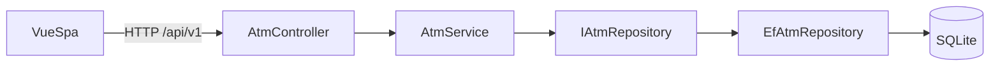
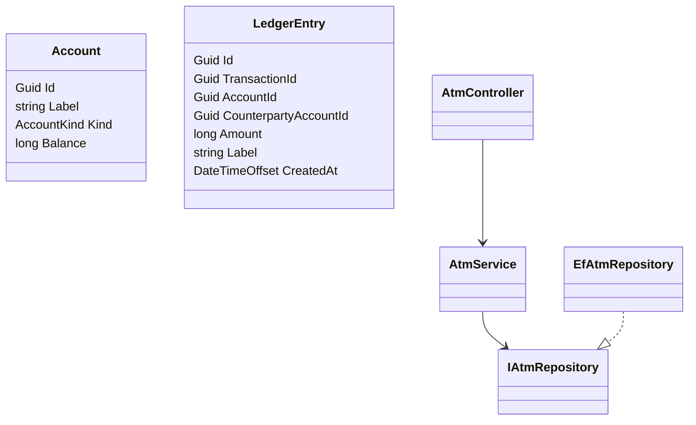
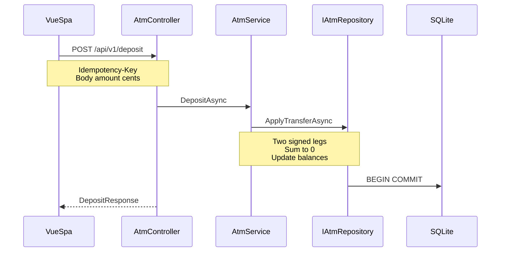

# Architecture

## Overview

The ATM app is a Vue SPA plus an ASP.NET Core API. Money movements use double-entry bookkeeping. Amounts are **integer cents**. Timestamps are **UTC** (`createdAt`).

## Layers

1. **HTTP** — `AtmController` (`/api/v1`), plus unversioned `GET /api/health`
2. **Service** — `AtmService` (reads, deposit, withdraw, transfer, idempotency)
3. **Repository** — `IAtmRepository` / `EfAtmRepository` (EF Core + SQLite)

Domain types do not depend on EF. EF Core is the standard .NET ORM; raw SQL is available later via EF without changing the domain seam.

## Double-entry ledger

Each economic event has a shared `transactionId` and **two** `LedgerEntry` legs. Amounts are signed cents (positive = credit, negative = debit). Legs for a `transactionId` always sum to **0**.

| Operation | Movement |
| --- | --- |
| Deposit | ATM → customer |
| Withdraw | customer → ATM |
| Transfer | customer → customer |
| Opening (init only) | Equity → Checking / Savings |

### Labels

- Deposit (customer leg): `Deposit from {ATM.Label}`
- Withdraw (customer leg): `Withdraw to {ATM.Label}`
- Transfer from A to B: A gets `Transfer to {B.Label}`; B gets `Transfer from {A.Label}`

### Cached balance

`Account.Balance` is updated in the same DB transaction as new legs so `GET /accounts` stays fast. Ledger amounts remain the audit source of truth.

## Mutating endpoints

- `POST /api/v1/deposit` — body `DepositRequest` `{ to, amount }`
- `POST /api/v1/withdraw` — body `WithdrawRequest` `{ from, amount }`
- `POST /api/v1/transfer` — body `TransferRequest` `{ from, to, amount }`

## Idempotency

Mutating POSTs require the `Idempotency-Key` request header, following the [The Idempotency-Key HTTP Header Field](https://datatracker.ietf.org/doc/draft-ietf-httpapi-idempotency-key-header/) (not yet an RFC). Clients generate a unique key (UUID recommended). The server fingerprints the request body with the key: same key and body replay the original success response after the ledger commit; same key with a different body yields `409` (the draft suggests `422` for that conflict; this API uses `409`). Missing key yields `400`.

## API envelopes

Top-level types end in `Response` and include `error` plus resource fields. Nested types (`Account`, `Transaction`) do not use the `Response` suffix.

Deposit / withdraw responses include `to` / `from` (matching the request). The customer account’s leg is on `latestTransaction` of that account.

Swagger UI: `/swagger` (not `/api`). Endpoint summaries, schemas, headers, and HTTP status codes
(including `400` insufficient funds on withdraw/transfer, `404`, and `409` idempotency conflict)
are documented there via OpenAPI.

## Class relationships

## Sequence: deposit

## Audit trail decision

**Decision (current scope):** Keep the double-entry ledger with Equity opening balances and ATM system account as implemented. That is enough for this sample’s auditability (immutable legs, legs sum to zero, cached balance rebuildable from the ledger).

**Deferred:** Stricter production controls (vault cash inventory separate from dispensed cash, stronger immutability/append-only enforcement at the storage layer, exportable audit packages). Revisit when requirements for physical cash reconciliation or regulatory audit appear. See README Next steps.

## ATM balance note

Under the current withdraw model (customer → ATM), the ATM account balance increases as cash is dispensed. It does **not** represent cash remaining in a vault. Low-cash alerts need a different model later.
